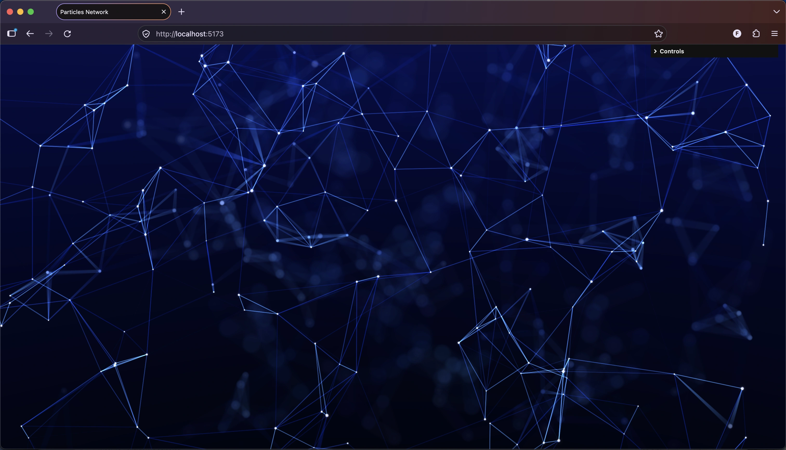

# Particles Network

A highly customizable 3D particle network visualization built with [Three.js](https://threejs.org/). Thousands of glowing particles drift organically through space on a smooth noise field, and nearby particles are linked by lines that form and break as they move, creating a living, web-like structure that slowly rotates.



Depth of field is an analytic circle-of-confusion blur, computed in the dot and line shaders directly. Each one measures its distance from the focal plane and scatters its own light across a disc of that size. Performance is even better than applying BokehPass as no postprocessing pipeline is needed and computation is more lightweight. Initially I've tried Three.js's [BokehPass](https://threejs.org/docs/#examples/en/postprocessing/BokehPass) but it did not work with the points/lines anyway as they never write depth properly.

These can all be tweaked live through a [lil-gui](https://lil-gui.georgealways.com/) control panel:

- **Distribution** — particle count, spread, clustering
- **Motion** — speed, amplitude, noise scale, rotation
- **Dots** — color, size, opacity, glow
- **Lines** — near and far color, thickness, opacity, connection distance, connection cap, fade time
- **Depth of field** — circle-of-confusion blur: auto focus, focus distance and range, aperture, blur size, softness, energy
- **Sky** — zenith and opposite colors

## Setup

Download [Node.js](https://nodejs.org/en/download/).
Run the following commands:

```bash
# Install dependencies (only the first time)
pnpm i

# Run the local server at localhost:5173
pnpm dev

# Build for production in the dist/ directory
pnpm build
```
